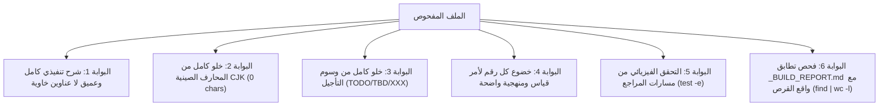

# خطة المراجعة والتدقيق 2: أنظمة SYS_09..15 + ملفات الجذر

> **الهدف:** تنفيذ فحص وتدقيق مستقل وصارم لـ 11 ملفاً داخل مستودع `/sdcard/wikillm/argon_version/wiki_ver2/` بناءً على البوابات الدستورية الست، ومقارنة إحصائيات تقرير البناء بواقع القرص، وتوليد التقرير النهائي الميداني في `/sdcard/wikillm/argon_version/_agy_logs/review2.md` دون المساس أو تعديل أي ملف مفحوص.

---

## 1. نطاق المراجعة والملفات المستهدفة (Allowed Read Scope)

المراجعة مقتصرة حصرياً على الملفات الـ 11 التالية (قراءة وفحص):
1. `systems/SYS_09_CUMULATIVE_SYNTHESIS.md`
2. `systems/SYS_10_INDEXES.md`
3. `systems/SYS_11_BUSINESS_EXECUTION.md`
4. `systems/SYS_12_AUDIT.md`
5. `systems/SYS_13_DELEGATION.md`
6. `systems/SYS_14_ANTI_PATTERNS.md`
7. `systems/SYS_15_DYNAMIC_EXPANSION.md`
8. `README.md`
9. `START_HERE.md`
10. `AGENTS.md`
11. `_BUILD_REPORT.md`

**ملف الإخراج الوحيد المصرح بكتابته:**
- `/sdcard/wikillm/argon_version/_agy_logs/review2.md`

> [!IMPORTANT]
> **قيد عدم التعديل:** لن يتم إجراء أي تعديل أو مساس بأي من الملفات الـ 11 المفحوصة داخل المستودع إطلاقاً.

---

## 2. معايير وبوابات التدقيق الست (Evaluation Gates)



1. **شرح تنفيذي كامل لا عناوين:** التأكد من احتواء كل قسم على توجيهات تشغيلية صريحة، وحظر العناوين الهيكلية المجردة أو النصوص السطحية.
2. **صفر حرف صيني (Zero CJK):** التحقق البرمجي الدقيق من النطاق الموحد `[\u4e00-\u9fff]`.
3. **لا وسوم تأجيل فعلية:** حظر وجود نصوص ناقصة أو مؤجلة (`TODO`, `TBD`, `XXX`, `[اكتب هنا]`).
4. **لا أرقام بلا أمر قياس:** إخضاع أي رقم أو إحصائية لقاعدة `sima_yi` (وجود أمر قياس أو سند تاريخي صريح).
5. **سلامة المسارات المرجعية (`test -e`):** فحص وجود كافة المسارات والمصادر المذكورة على القرص الفعلي.
6. **مطابقة تقرير البناء `_BUILD_REPORT.md` مع القرص:** تشغيل أمر عد الأنظمة `SYS_*.md` ومقارنة ما أُنجز في الواقع بما يدعيه التقرير.

---

## 3. نتائج الفحص الاستكشافي الميداني (Evidence & Findings)

### 3.1 فحص النقاء اللغوي (CJK Check)
- **الأمر:** فحص بايثون لكافة الملفات الـ 11.
- **النتيجة الحرفية:** `0 CJK` في كافة الملفات (نجاح كامل للبوابة 2).

### 3.2 فحص الوسوم المؤقتة (Placeholder Check)
- لا توجد وسوم تأجيل تشغيلية متروكة.
- تنويه: ذِكر وسوم `TODO/TBD/XXX` في `SYS_11` و `SYS_12` و `SYS_13` و `_BUILD_REPORT` جاء حصراً داخل أوامر فحص Shell وقواعد المنع الدستورية، وقالب `AGENTS.md` يمثل تعريفاً معيارياً لبنية سجل القرارات.

### 3.3 فحص المسارات المرجعية (`test -e`)
- **الملفات المتوافقة بالكامل (PASS):**
  - `SYS_09_CUMULATIVE_SYNTHESIS.md`: كافة مسارات الماستر والمصادر الخارجية موجودة وتعمل.
  - `SYS_10_INDEXES.md`: عقد الفهارس والمصادر الحقيقية موجودة.
  - `SYS_11_BUSINESS_EXECUTION.md`: مراجع الماستر والـ brain مثبتة على القرص.
  - `SYS_12_AUDIT.md`: وثائق البوابات والمفاهيم التمثيلية موجودة.
  - `SYS_13_DELEGATION.md`: سجل NB2 والمحاكاة مثبتة على القرص.
  - `SYS_14_ANTI_PATTERNS.md`: وثائق المحاكاة ومكافحة المعادلات الميتة موجودة.
  - `SYS_15_DYNAMIC_EXPANSION.md`: مراجع التوسع ومجلد domains ومصنف audit مثبتة.
  - `README.md`: كافة الروابط التشعبية للملفات التأسيسية والأنظمة الخمسة الأولى والأدوات موجودة.
  - `AGENTS.md`: خالٍ من أي روابط مكسورة.
- **الملف الذي رُصدت فيه اختلالات مسارات (ISSUES):**
  - `START_HERE.md`: وردت في الشجرة المعمارية (الأسطر 59 إلى 68) 7 أسماء لملفات أنظمة لا تطابق التسميات الحقيقية المنشأة على القرص:
    * السطر 59: `SYS_06_TERMINOLOGY_DEEPENING.md` (الاسم الحقيقي على القرص: `SYS_06_TERMS_DEEPENING.md`).
    * السطر 61: `SYS_08_OPINION_PLURALISM.md` (الاسم الحقيقي على القرص: `SYS_08_PLURALISM.md`).
    * السطر 62: `SYS_09_INCREMENTAL_SYNTHESIS.md` (الاسم الحقيقي على القرص: `SYS_09_CUMULATIVE_SYNTHESIS.md`).
    * السطر 63: `SYS_10_INDEXES_AND_RETRIEVAL.md` (الاسم الحقيقي على القرص: `SYS_10_INDEXES.md`).
    * السطر 65: `SYS_12_AUDIT_AND_GATES.md` (الاسم الحقيقي على القرص: `SYS_12_AUDIT.md`).
    * السطر 66: `SYS_13_DELEGATION_WORKERS.md` (الاسم الحقيقي على القرص: `SYS_13_DELEGATION.md`).
    * السطر 68: `SYS_15_DYNAMIC_SCALING.md` (الاسم الحقيقي على القرص: `SYS_15_DYNAMIC_EXPANSION.md`).

### 3.4 فحص تقرير البناء `_BUILD_REPORT.md` (Disk Truth vs Report)
- **أمر القرص المنفذ:**
  ```bash
  find /sdcard/wikillm/argon_version/wiki_ver2/systems -name "SYS_*.md" | wc -l
  ```
- **المخرج الحرفي:** `15`
- **المقارنة بواقع التقرير:**
  - التقرير وُثق للموجة 1 فقط (`_BUILD_REPORT.md (الموجة 1)`).
  - يزعم التقرير في الأسطر 10، 14، 101، 102 أن المنجز هو 8 ملفات فقط (SYS_01 إلى SYS_05 + الجذر)، وأن SYS_06 إلى SYS_15 ومجلدات tools و domains لم تُنجز بعد.
  - **الواقع على القرص:** كافة الأنظمة الـ 15 (`SYS_01` إلى `SYS_15`) مبنية وموجودة فعلياً، وأدوات `tools/` ومجلدات `domains/` مبنية بالكامل.
  - التقرير راكد (Stale) ولا يعكس اكتمال الموجات التالية.

---

## 4. خطة إنشاء التقرير النهائي `review2.md`

بمجرد اعتماد هذه الخطة، سيتم توليد الملف `/sdcard/wikillm/argon_version/_agy_logs/review2.md` بالصيغة الدقيقة المطلوبة:
- سطر صريح لكل ملف: `PASS` أو حصر المشاكل المحددة بأرقام أسطرها.
- إدراج مخرجات أوامر Shell المنفذة كإثبات قطعي وفق قاعدة `R09`.

```text
/sdcard/wikillm/argon_version/_agy_logs/review2.md
├── systems/SYS_09_CUMULATIVE_SYNTHESIS.md: PASS
├── systems/SYS_10_INDEXES.md: PASS
├── systems/SYS_11_BUSINESS_EXECUTION.md: PASS
├── systems/SYS_12_AUDIT.md: PASS
├── systems/SYS_13_DELEGATION.md: PASS
├── systems/SYS_14_ANTI_PATTERNS.md: PASS
├── systems/SYS_15_DYNAMIC_EXPANSION.md: PASS
├── README.md: PASS
├── START_HERE.md: ISSUES (L59, L61, L62, L63, L65, L66, L68 - مسارات أنظمة متباينة عن أسماء القرص الحقيقية)
├── AGENTS.md: PASS
└── _BUILD_REPORT.md: ISSUES (L10, L14, L101-102 - تقرير راكد يزعم عدم بناء SYS_06..15 بينما القرص يحوي 15 ملفاً فعلياً)
```

---

## 5. خطة التحقق بعد التنفيذ (Verification Plan)

بعد كتابة التقرير، سنقوم بالتحقق عبر الأوامر التالية:
1. `test -s /sdcard/wikillm/argon_version/_agy_logs/review2.md` للتحقق من وجود الملف وامتلاء محتواه.
2. فحص النقاء اللغوي للتقرير نفسه (صفر محارف صينية).
3. التأكد من عدم تعديل أي من الملفات الـ 11 الأصلية (`git status` أو مقارنة أوقات التعديل).
